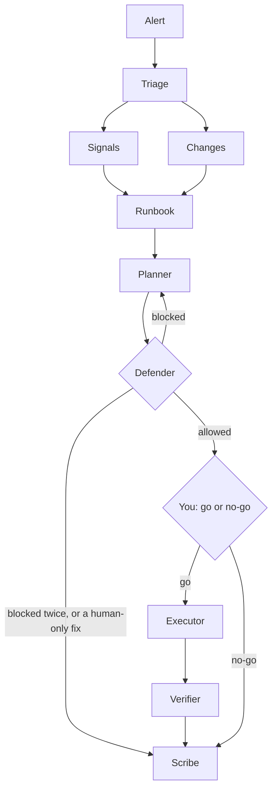

# Aegis War Room


**An alert fires → a team of AI agents investigates out loud → a defender checks their fix → you say go or no-go → only then is anything changed.**
It runs with no cloud and no API key. Azure OpenAI, AWS Bedrock and Google Vertex AI are one dropdown away. A voice assistant briefs you and takes "go" and "no-go" by voice.


```text
$ aegis demo
     triage | Critical incident on payment. Payment service error rate is above 40% for 3 minutes. Customers cannot check out.
    signals | I quarantined 1 log line written to look like instructions for an AI. No agent will act on that text.
    changes | Feature flag paymentFailure: switched from off to 50%, 4 minutes before the alert (by release-bot).
    signals | payment is unhealthy: error rate 42.0% (normal 0.4%), p95 latency 2300 ms (normal 180 ms).
    runbook | Closest runbook: “Payment errors and failed charges”.
    planner | Root cause: The feature flag paymentFailure was switched on shortly before the trouble started ... I propose to switch the feature flag paymentFailure to off.
   defender | Checked against policy: all 6 checks pass, risk low. Note: 1 injected line was removed before planning.
      aegis | Waiting for a human: go or no-go on the plan to switch the feature flag paymentFailure to off?

  Your call. Type go or no-go: go

   executor | Done as approved: set_feature_flag done: paymentFailure is now off.
   verifier | Recovered. Error rate is 0.8% and p95 latency is 190 ms.
     scribe | Incident closed: resolved. Postmortem draft and team update are ready.
```

## Start here

This section is written for anyone. Go step by step and stop at the step you need. Everything works offline first, so you can try it before you have any keys.

### What you need

| What you want to do | What you need |
|---|---|
| **Try it** in the terminal | Python 3.11 or newer, Git |
| **Open the war room screen** | the above, plus Node.js 22 or newer |
| **Use the voice** | Chrome or Edge. Speaking works in most browsers; listening needs Chrome or Edge |
| **Use a real AI model** | an Azure OpenAI deployment, or AWS Bedrock access, or a Google Cloud project with Vertex AI |
| **Run against a real system** | Docker with about 8 GB of memory, for the [OpenTelemetry Demo](https://opentelemetry.io/docs/demo/) shop |

On Windows, use WSL2.

### Step 1: try it in the terminal (2 minutes, nothing else needed)

```bash
git clone https://github.com/debanjan0212/aegis-war-room.git
cd aegis-war-room
python3 -m venv .venv && source .venv/bin/activate
pip install -e ".[dev]"

aegis demo                                   # the payment incident above. It asks you: go or no-go
aegis demo --scenario recommendation-slow    # a different service and a different flag
aegis demo --scenario bad-deploy             # the fix is a rollback, which agents may not do, so Aegis hands over
aegis drill                                  # eight attacks on the defences. All eight must say HELD
aegis scan                                   # the Code Guard agent scans this repository
make test
```

No `make` on your machine? Every `make` target is one line in the `Makefile`.

### Step 2: open the war room screen

```bash
cd web && npm ci && cd ..      # once: install the screen's libraries
make serve                     # builds the screen and starts everything
```

Open **http://localhost:8000**. Pick an incident and watch the stations along the top report in one by one. When "You" lights up, it is your call.

### Step 3: turn on the voice

On the screen, switch **Speaking** on to hear the briefing, and **Listening** on to answer by voice (the browser asks for the microphone once).

- Say **"no-go"** and it stops at once.
- Say **"go"**, then **"confirm"**, and it proceeds. Acting always takes two steps; stopping takes one.
- Say **"brief me"** to hear the briefing again.

The **Voice** menu lists every folder in [`voices/`](voices/). Two stock voices ship with the repo. To add your own voice, see [`voices/README.md`](voices/README.md).

### Step 4: switch the model

The **Model** menu is the toggle. Each entry is a few lines in [`config/models.yaml`](config/models.yaml), so moving between clouds is a setting, not a code change.

```bash
pip install -e ".[cloud]"       # once: the Azure, AWS and Google libraries
cp .env.example .env            # fill in the block for the cloud you use
set -a; source .env; set +a
make serve
```

A model shows as "(not set up)" until its settings are present. If a cloud model fails in the middle of an incident, the agent says so on its strip and carries on with the offline rules. An incident never stops because a model did.

### Step 5: run it against a real system

```bash
# Terminal 1: the demo shop with Prometheus and Grafana
git clone https://github.com/open-telemetry/opentelemetry-demo.git
cd opentelemetry-demo && make start

# Terminal 2: Aegis, pointed at it
export AEGIS_SOURCE=otel-demo
export OTEL_DEMO_FLAG_FILE=/full/path/to/opentelemetry-demo/src/flagd/demo.flagd.json
export AEGIS_VERIFY_TRIES=8 AEGIS_VERIFY_WAIT=15     # real numbers take a minute or two to settle
make serve
```

Break something: open the shop's flag page at http://localhost:8080/feature and set `paymentFailure` to 50%. Wait about two minutes, then press **Scan the live system now** on the Aegis screen. Aegis also accepts alerts as a webhook at `POST /api/alerts` in the Alertmanager and Grafana format.

## How an incident flows



| Agent | Its one job |
|---|---|
| Triage | How bad is it, and which service is hurt? |
| Signals | What do the metrics, logs and traces say? Quarantines log lines that try to instruct the AI |
| Changes | What changed just before this started? |
| Runbook | Which of the team's written procedures fits? |
| Planner | The root cause and **one** proposed action, chosen from an allowed list |
| Defender | Checks the plan against fixed rules. Uses no AI model, so it cannot be talked into anything |
| You | Go or no-go |
| Executor | Runs the approved action and nothing else |
| Verifier | Checks the numbers again. "Applied" is not "worked" |
| Scribe | Writes the postmortem draft and the message for the team |
| Code Guard | Separate from incidents: scans this repository for vulnerabilities |

## What keeps it safe

- **The AI cannot invent an action.** The planner must pick from the actions enabled in [`config/policy.yaml`](config/policy.yaml). Today that is: switch a failure flag off, or hand over to a human.
- **The defender is rules, not a model.** It checks every plan before you see it, and the executor checks again before acting.
- **Nothing runs without a human go**, and the go is tied to a fingerprint of the exact plan. A plan changed after approval is refused.
- **Logs are treated as hostile.** Lines that read like instructions to an AI are quarantined and shown to you, never to the model.
- **Everything is recorded** in an audit log where each line is chained to the one before, so edits show up.
- **The code is scanned** on every change: dependencies, code, secrets, the Dockerfile and the pipeline itself.

Details, and what is not covered yet, are in [`SECURITY.md`](SECURITY.md).

## Where things are

```text
aegis/                the backend (Python)
  agents/             one file per agent: triage, signals, changes, runbook, planner, defender, executor, verifier, scribe, codeguard
  connectors/         how Aegis reads from and acts on the outside world: simulator.py and otel_demo.py
  security/           policy.py (the rules), injection.py (the log filter), drill.py (the attack tests)
  flow.py             the order the agents speak in, and the go / no-go pause
  brain.py            the model toggle
  store.py            incidents, the live feed and the audit log
  server.py           the web API
  voices.py           the voice toggle
  cli.py              the `aegis` command
config/               settings you can change without touching code
scenarios/            the simulated incidents
runbooks/             the team's written procedures, as plain Markdown
voices/               one folder per voice
web/                  the screen (React, Vite, Tailwind)
tests/                the tests
docs/                 PLAN.md (hackathon day), ROADMAP.md (the long-term goal), ARCHITECTURE.md (how it is built)
```

## Change things without touching code

| To do this | Edit this |
|---|---|
| Add or change a model | `config/models.yaml` |
| Allow, forbid or limit an action | `config/policy.yaml` |
| Add a simulated incident | copy a file in `scenarios/` |
| Add a runbook | drop a Markdown file in `runbooks/` |
| Add a voice | copy `voices/_template/` |
| Point at different metrics | `config/otel-demo.yaml` |

## Branches

This repository follows Gitflow: `main` is released code, `develop` is the next release, and every change is a pull request into `develop`. The steps are in [`CONTRIBUTING.md`](CONTRIBUTING.md).

## Where this is going

One repository and ten agents today. The long-term goal is nine repositories and about twenty-two agents in seven squads, each added only when it is needed. The repositories, the branch rules, every agent and how they work together are in [`docs/ROADMAP.md`](docs/ROADMAP.md).

## What is not done yet

Being straight about the edges:

- **Cloud models are wired but not proven.** The Azure and Bedrock clients build and accept the structured answers; no real model call has been made from this repository yet. Vertex needs your Google login before it can even be built. Test each cloud you plan to show.
- **Live mode is tested against recorded answers, not a running shop.** Metrics, flags, the fix and the re-check are implemented; logs and traces from the live shop are not.
- **Voice cloning is not installed.** The voice menu, the folder layout and the consent check are there. The engine that speaks in a recorded person's voice is the next step.
- **No login.** It listens on your own machine only. `AEGIS_API_TOKEN` protects the API for scripts; a real login is needed before this goes on a shared network.
- **Incidents live in memory.** Restarting the server forgets open incidents. The audit log on disk survives.

The order these get done in is in [`docs/PLAN.md`](docs/PLAN.md). Where it goes after that is in [`docs/ROADMAP.md`](docs/ROADMAP.md).

## License

MIT. See [`LICENSE`](LICENSE).
