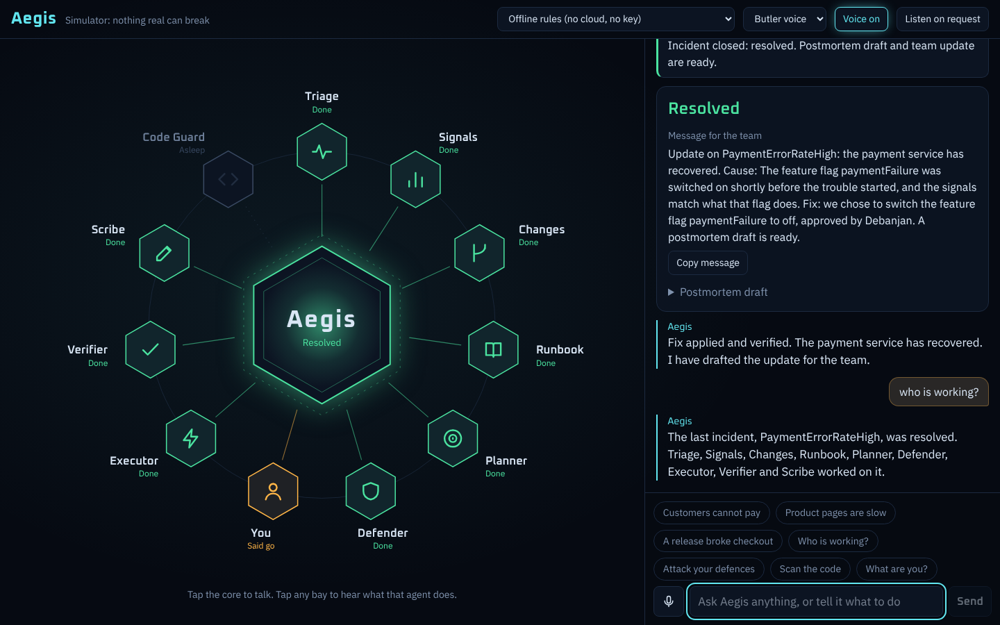
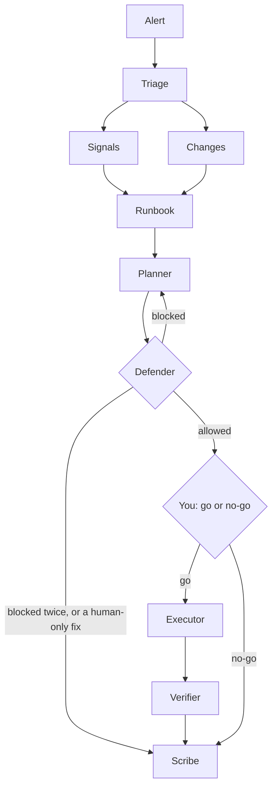

# Aegis War Room


**An alert fires → a team of AI agents investigates out loud → a defender checks their fix → you say go or no-go → only then is anything changed.**
It runs with no cloud and no API key. A model on your own laptop (Ollama), Azure OpenAI, AWS Bedrock and Google Vertex AI are one dropdown away. A voice assistant briefs you and takes "go" and "no-go" by voice.



```text
$ aegis demo
     triage | Critical incident on payment. Payment service error rate is above 40% for 3 minutes. Customers cannot check out.
    signals | I quarantined 1 log line written to look like instructions for an AI. No agent will act on that text.
    changes | Feature flag paymentFailure: switched from off to 50%, 4 minutes before the alert (by release-bot).
    signals | payment is unhealthy: error rate 42.0% (normal 0.4%), p95 latency 2300 ms (normal 180 ms).
    runbook | Closest runbook: “Payment errors and failed charges”.
    planner | Root cause: The feature flag paymentFailure was switched on shortly before the trouble started ... I propose to switch the feature flag paymentFailure to off.
   defender | Checked against policy: all 6 checks pass, risk low. Note: 1 injected line was removed before planning.
      aegis | Waiting for a human: go or no-go on the plan to switch the feature flag paymentFailure to off?

  Your call. Type go or no-go: go

   executor | Done as approved: set_feature_flag done: paymentFailure is now off.
   verifier | Recovered. Error rate is 0.8% and p95 latency is 190 ms.
     scribe | Incident closed: resolved. Postmortem draft and team update are ready.
```

## Start here

This section is written for anyone. Go step by step and stop at the step you need. Everything works offline first, so you can try it before you have any keys.

### What you need

| What you want to do | What you need |
|---|---|
| **Try it** in the terminal | Python 3.11 or newer, Git |
| **Open the war room screen** | the above, plus Node.js 22 or newer |
| **Use the voice** | Chrome or Edge. Speaking works in most browsers; listening needs Chrome or Edge |
| **Use a real AI model** | [Ollama](https://ollama.com) on your laptop (free, no account), or an Azure OpenAI deployment, AWS Bedrock access, or a Google Cloud project with Vertex AI |
| **Run against a real system** | Docker with 8 GB of memory, for the [OpenTelemetry Demo](https://opentelemetry.io/docs/demo/) shop |

On Windows, use WSL2.

### Step 1: try it in the terminal (2 minutes, nothing else needed)

```bash
git clone https://github.com/debanjan0212/aegis-war-room.git
cd aegis-war-room
python3 -m venv .venv && source .venv/bin/activate
pip install -e ".[dev]"

aegis demo                                   # the payment incident above. It asks you: go or no-go
aegis demo --scenario recommendation-slow    # a different service and a different flag
aegis demo --scenario bad-deploy             # the fix is a rollback, which agents may not do, so Aegis hands over
aegis drill                                  # eight attacks on the defences. All eight must say HELD
aegis scan                                   # the Code Guard agent scans this repository
aegis models                                 # which models are set up, and what each one still needs
make test
```

No `make` on your machine? Every `make` target is one line in the `Makefile`.

### Step 2: open the shelter

```bash
cd web && npm ci && cd ..      # once: install the screen's libraries
make serve                     # builds the screen and starts everything
```

Open **http://localhost:8000** in Chrome and press **Wake Aegis**. The core lights up, the crew comes online one bay at a time, and Aegis greets you by name, out loud. Put `AEGIS_OPERATOR_NAME=YourName` in `.env` so it never has to ask.

- **The shelter** is the whole crew around Aegis, each agent in its own colour. Each bay says what that agent is doing right now: asleep (dim), standing by, working (spinning, with data pulses flowing to the core), done, blocked (red), or your call (gold). Tap a bay to hear what that agent does. The readouts show the clock, how many agents are working, done and asleep, and the last transmission.
- **Talk to it** in your own words, typed or by the microphone button (or tap the core): "run the payment drill", "who is working?", "scan the code", "attack your defences", "what are you?". The chips under the conversation are shortcuts.
- **The conversation** on the right holds your messages, Aegis's replies, every agent's report and the go / no-go, in one thread.

### Step 3: decide by voice

When a plan is ready, the "You" bay and the core turn amber and Aegis reads the briefing.

- Say **"no-go"** and it stops at once.
- Say **"go"**, then **"confirm"**, and it proceeds. Acting always takes two steps; stopping takes one.
- Say **"brief me"** to hear the briefing again.

Go and no-go are matched word for word on the screen. They never go to a model, so no phrasing can approve a fix by accident. **Always listening** in the top bar treats everything the microphone hears as a message; leave it off in a noisy room and use the microphone button instead.

The **Voice** menu lists every folder in [`voices/`](voices/). Two stock voices ship with the repo. To add your own voice, see [`voices/README.md`](voices/README.md).

### You do not need an AI model

The **Model** menu starts on **Offline rules**, and everything in steps 1 to 3 already ran that way. In this mode each agent uses built-in rules instead of an AI model, and the whole loop works: investigate, plan, defender check, go / no-go, fix, verify, write-up. The tests and CI run like this too.

What you give up without a model: the rules understand the kinds of incident in [`scenarios/`](scenarios/) (a flag switched on by mistake, a bad release). Faced with anything else they hand over to a human instead of guessing. A model adds judgement on incidents the rules have not seen, and better-written summaries. The defender, the go / no-go and the audit log are the same either way.

### Step 4: switch the model (optional)

The **Model** menu is the toggle. Each entry is a few lines in [`config/models.yaml`](config/models.yaml), so moving between a laptop model and the clouds is a setting, not a code change. Settings go in a `.env` file, which `aegis` reads by itself:

```bash
cp .env.example .env            # once. Then fill in only the blocks you use
```

**A model on your laptop (Mac, Linux or Windows).** Nothing leaves the machine and there is no key.

1. Install [Ollama](https://ollama.com) (on a Mac: download the app, or `brew install ollama`) and open it once.
2. Pull a model that fits your memory:

   | Your laptop's memory | With the demo shop running (step 5) | Without the shop |
   |---|---|---|
   | 8 GB | use a cloud model instead | `qwen2.5:3b` |
   | 16 GB | `qwen2.5:3b` | `qwen2.5:7b` |
   | 32 GB or more | `qwen2.5:7b` | `qwen2.5:14b` |

   ```bash
   ollama pull qwen2.5:7b
   ```
3. Tell Aegis which one, and check it answers:

   ```bash
   pip install -e ".[local]"      # once: the Ollama library
   # in .env:  OLLAMA_MODEL=qwen2.5:7b   and, to use it by default,  AEGIS_MODEL=local
   aegis models --test            # "ANSWERED" means the agents can use it
   ```

Other models work too if they can answer in a fixed JSON shape: change `OLLAMA_MODEL`, pull it, and run `aegis models --test`.

**A cloud model.**

```bash
pip install -e ".[cloud]"       # once: the Azure, AWS, Google and Ollama libraries
# fill in the block for your cloud in .env
aegis models --test
```

Then `make serve` and pick the model in the menu. A model shows as "(not set up)" until its settings are present; `aegis models` says exactly what is missing. If a model fails in the middle of an incident, the agent says so on its strip and carries on with the offline rules. An incident never stops because a model did.

### Step 5: run it against a real system

The [OpenTelemetry Demo](https://opentelemetry.io/docs/demo/) is a real online shop made of many small services, with Prometheus and Grafana. Start Docker (on a Mac, Docker Desktop with 8 GB of memory in Settings, Resources), then:

```bash
make shop        # first time: downloads the shop next to this folder and its images (several GB, do it on good Wi-Fi)
make live        # the war room, pointed at the shop and watching it by itself
```

Open http://localhost:8000. Now break something: open the shop's flag page at http://localhost:8080/feature and set `paymentFailure` to 50%. Within a minute or two the room wakes up by itself and asks you for go or no-go. Say go, and watch the verifier see the shop recover.

- The watcher uses the default model (`AEGIS_MODEL` in `.env`), not the menu. Set `AEGIS_MODEL=local` to have the laptop model answer.
- After an incident, the watcher waits three minutes before it opens another one for the same service (`AEGIS_WATCH_QUIET`), so a no-go is not asked again and again.
- `make shop` sets the shop to update its numbers every 15 seconds instead of every minute, so failure and recovery show up quickly. It only does this if you have not changed that file yourself.
- `make shop-stop` stops the shop and gives the memory back.
- If you would rather press a button than watch: `make serve` with `AEGIS_SOURCE=otel-demo` in `.env`, then **Scan the live system now**. Aegis also accepts alerts as a webhook at `POST /api/alerts` in the Alertmanager and Grafana format.

### Step 6: show it to other people

| Where they are | What to do |
|---|---|
| In the room, or on a call | `make serve`, open http://localhost:8000 and share your screen. Switch **Speaking** on so they hear the briefing |
| On the same Wi-Fi, on their own devices | Start it with a token (below) and give them the link |
| On a machine with Docker | `docker build -t aegis-war-room .` then `docker run --rm -p 127.0.0.1:8000:8000 aegis-war-room`, and open http://localhost:8000 |

To let others on your network open it:

```bash
export AEGIS_API_TOKEN=$(python3 -c "import secrets; print(secrets.token_urlsafe(24))")
aegis serve --host 0.0.0.0
echo "http://<your computer's IP address>:8000/?token=$AEGIS_API_TOKEN"
```

Anyone who opens that link can start a drill and press go, so share it only with the people in the room. There is no login yet. Do not put this on the public internet.

## How an incident flows



| Agent | Its one job |
|---|---|
| Triage | How bad is it, and which service is hurt? |
| Signals | What do the metrics, logs and traces say? Quarantines log lines that try to instruct the AI |
| Changes | What changed just before this started? |
| Runbook | Which of the team's written procedures fits? |
| Planner | The root cause and **one** proposed action, chosen from an allowed list |
| Defender | Checks the plan against fixed rules. Uses no AI model, so it cannot be talked into anything |
| You | Go or no-go |
| Executor | Runs the approved action and nothing else |
| Verifier | Checks the numbers again. "Applied" is not "worked" |
| Scribe | Writes the postmortem draft and the message for the team |
| Code Guard | Separate from incidents: scans this repository for vulnerabilities |

## What keeps it safe

- **The AI cannot invent an action.** The planner must pick from the actions enabled in [`config/policy.yaml`](config/policy.yaml). Today that is: switch a failure flag off, or hand over to a human.
- **The defender is rules, not a model.** It checks every plan before you see it, and the executor checks again before acting.
- **A change must target what the evidence points at.** If a model proposes a plausible fix to something the investigation never named, the defender blocks it. You are never asked to approve a change nobody can connect to the incident.
- **Nothing runs without a human go**, and the go is tied to a fingerprint of the exact plan. A plan changed after approval is refused.
- **Logs are treated as hostile.** Lines that read like instructions to an AI are quarantined and shown to you, never to the model.
- **Everything is recorded** in an audit log where each line is chained to the one before, so edits show up.
- **The code is scanned** on every change: dependencies, code, secrets, the Dockerfile and the pipeline itself.

Details, and what is not covered yet, are in [`SECURITY.md`](SECURITY.md).

## Watch the war room itself

The agents that answer incidents are agents too, so they can be put under an error budget like any other. Set
the standard OpenTelemetry variables and Aegis sends a trace for each half of an incident, in the GenAI
conventions:

```bash
export OTEL_EXPORTER_OTLP_ENDPOINT=http://localhost:8600            # Themis, or any OTLP/HTTP backend
export OTEL_EXPORTER_OTLP_HEADERS="Authorization=Bearer%20<ingest key>"
aegis demo --approve go
```

One trace runs from the alert to the go / no-go question, the other from your answer to the postmortem; both
carry the incident id as the session. Each agent is an `invoke_agent` span, each model question a `chat` span
with its token counts (a model that fails is an error, and the offline rules are not reported as a model), and the
change itself is an `execute_tool` span marked approved or refused by a human. Prompts and model answers are
never recorded, because they can hold what an attacker wrote into a log line. Without the variables nothing is
sent. [Themis](https://github.com/debanjan0212/themis-agent-sre) reads these traces and also sends Aegis its
incidents through `/api/alerts`.

## Where things are

```text
aegis/                the backend (Python)
  agents/             one file per agent: triage, signals, changes, runbook, planner, defender, executor, verifier, scribe, codeguard
  connectors/         how Aegis reads from and acts on the outside world: simulator.py and otel_demo.py
  security/           policy.py (the rules), injection.py (the log filter), drill.py (the attack tests)
  flow.py             the order the agents speak in, and the go / no-go pause
  assistant.py        Aegis itself: turns what you say into one command, and answers from the record
  brain.py            the model toggle
  store.py            incidents, the live feed and the audit log
  server.py           the web API, and the watcher that looks at a live system by itself
  voices.py           the voice toggle
  cli.py              the `aegis` command
config/               settings you can change without touching code
scenarios/            the simulated incidents
runbooks/             the team's written procedures, as plain Markdown
voices/               one folder per voice
web/                  the screen (React, Vite, Tailwind)
tests/                the tests
docs/                 PLAN.md (hackathon day), ROADMAP.md (the long-term goal), BLUEPRINT.md (how to build each repository), ARCHITECTURE.md (how this one is built)
```

## Change things without touching code

| To do this | Edit this |
|---|---|
| Add or change a model | `config/models.yaml` |
| Allow, forbid or limit an action | `config/policy.yaml` |
| Add a simulated incident | copy a file in `scenarios/` |
| Add a runbook | drop a Markdown file in `runbooks/` |
| Add a voice | copy `voices/_template/` |
| Point at different metrics | `config/otel-demo.yaml` |

## Branches

This repository follows Gitflow: `main` is released code, `develop` is the next release, and every change is a pull request into `develop`. The steps are in [`CONTRIBUTING.md`](CONTRIBUTING.md).

## Where this is going

One repository and ten agents today. The long-term goal is nine repositories and about twenty-two agents in seven squads, each added only when it is needed. The repositories, the branch rules, every agent and how they work together are in [`docs/ROADMAP.md`](docs/ROADMAP.md). How to build each repository, step by step, is in [`docs/BLUEPRINT.md`](docs/BLUEPRINT.md).

## What is not done yet

Being straight about the edges:

- **Only the laptop model has answered for real.** `qwen2.5:7b` on an Apple M4 Pro played all three scenarios. The Azure and Bedrock clients build and accept the structured answers, but no cloud call has been made yet. Vertex needs your Google login before it can even be built. Run `aegis models --test` for every model you plan to show.
- **Live mode is tested against a stand-in Prometheus and a real flag file, not a running shop.** Watching, metrics, flags, the fix and the re-check work end to end against the stand-in; logs and traces from the live shop are not wired.
- **Voice cloning is not installed.** The voice menu, the folder layout and the consent check are there. The engine that speaks in a recorded person's voice is the next step.
- **No login.** It listens on your own machine only. `AEGIS_API_TOKEN` protects the API for scripts; a real login is needed before this goes on a shared network.
- **Incidents live in memory.** Restarting the server forgets open incidents. The audit log on disk survives.

The order these get done in is in [`docs/PLAN.md`](docs/PLAN.md). Where it goes after that is in [`docs/ROADMAP.md`](docs/ROADMAP.md).

## License

MIT. See [`LICENSE`](LICENSE).
