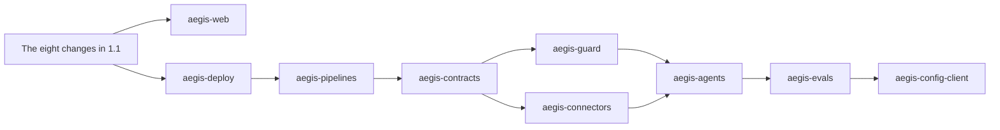

# The build blueprint

[`ROADMAP.md`](ROADMAP.md) says **what** the Aegis family becomes and **when** each piece is added. This document says **how**: what must exist first, what goes inside each repository, how it is laid out, and how you know it is finished. Open it on the day you start a new repository and work down the list.

It is a design, written before the code. Names are proposals, and the two protocols it leans on (A2A and MCP) should be tried in a small experiment before you commit to them. Change this document when reality disagrees with it.

**Contents**

- Part 1. Before you split anything
  - 1.1 Finish these while it is still one repository
  - 1.2 Accounts and platform you need
  - 1.3 What every repository starts with
  - 1.4 Names, versions and what gets published
  - 1.5 How to carve a folder out into its own repository
- Part 2. The repositories, one by one
- Part 3. Putting it together
  - 3.1 The order to build in
  - 3.2 Where today's files end up
  - 3.3 Environments and promotion
  - 3.4 Bringing on a client

---

## Part 1. Before you split anything

### 1.1 Finish these while it is still one repository

Splitting is cheap when the seams already exist and painful when they do not. Do these eight inside `aegis-war-room` first. Each is an ordinary `feature/` branch.

| # | Change | Why it must come first | Where it is today |
|---|---|---|---|
| 1 | Put the API under `/api/v1` and commit an `openapi.yaml` generated from it | The screen and every other caller need a contract that does not move under them | `aegis/server.py` |
| 2 | Login through single sign-on, with roles: viewer, approver, admin | Today "Deciding as" is a text box. The approver must come from the login | `aegis/server.py`, `web/src/components/Desk.tsx` |
| 3 | Postgres for incidents, events and the flow's saved state | Today a restart forgets open incidents | `aegis/store.py`, `aegis/flow.py` (`InMemorySaver`) |
| 4 | One file, `aegis/contracts.py`, holding every shape agents exchange: alert, finding, plan, verdict, decision, event | They are spread across the agent files now. One file turns the later move into a file move | `aegis/agents/*.py`, `aegis/flow.py` |
| 5 | A registry: the flow asks "which agents exist?" instead of importing them by name | Lets an agent be added, and later moved out, without editing the flow | `aegis/flow.py` |
| 6 | OpenTelemetry: one trace per incident, one span per agent step | You cannot run agents as separate services without seeing across them | new `aegis/telemetry.py` |
| 7 | Health and readiness endpoints; every setting from the environment or a mounted file | Kubernetes needs both | `aegis/server.py`, `aegis/settings.py` |
| 8 | A release pipeline: a tag on `main` builds the image, scans it, signs it and pushes it to the registry | `aegis-deploy` can only pin versions that exist | `.github/workflows/` |

**Done when:** this one repository can be installed on a cluster with Helm, a person can log in and approve, and an incident survives the server restarting in the middle of it.

### 1.2 Accounts and platform you need

| You need | What for | From phase |
|---|---|---|
| A GitHub organisation | Teams, shared secrets, rules applied to every repository at once. A personal account is fine until there are about three repositories | 2 |
| A container registry (GitHub Container Registry works) | Where images are published | 1 |
| A package registry for Python and npm | Where the shared library is published | 2 |
| A Kubernetes cluster with a `dev` namespace; later separate staging and production | Where it runs | 1, then 2 |
| Argo CD | Deploys what `aegis-deploy` says, and nothing else | 1 |
| Ingress, a DNS name and TLS certificates (cert-manager) | People reach it over HTTPS | 1 |
| A secrets store and the External Secrets Operator | No secret is ever in a repository | 1 |
| A single sign-on provider that speaks OIDC (Entra ID, Okta, Google) | Login and roles | 1 |
| Managed Postgres | Incidents and saved flow state | 1 |
| An OpenTelemetry collector and somewhere to store traces, metrics and logs | Seeing inside the agents | 1 |
| Model access on at least one cloud, reached by workload identity | No model keys in repositories or in CI | 1 |
| GitHub Actions trusted by your cloud through OIDC | CI publishes without long-lived keys | 1 |
| Image signing (cosign, keyless) and a cluster rule that refuses unsigned images | Only what CI built can run | 2 |
| An identity per service (Kubernetes service accounts, plus a mesh or SPIFFE for mutual TLS) | Each agent proves who it is | 2 |

### 1.3 What every repository starts with

The same skeleton everywhere, so anyone who knows one repository knows them all.

```text
<repository>/
├── README.md               what it is, "Start here" steps, where things are. Plain English
├── SECURITY.md             how to report, what is checked, what is not covered yet
├── CONTRIBUTING.md         the branch rules and "make check"
├── CHANGELOG.md            one entry per release
├── LICENSE
├── Makefile                the same targets in every repository: install, test, lint, scan, check
├── .env.example            every setting, commented out, with one line of explanation
├── .gitignore
├── .github/
│   ├── CODEOWNERS
│   ├── dependabot.yml      pull requests go to develop
│   └── workflows/
│       ├── ci.yml          calls aegis-pipelines
│       ├── security.yml    calls aegis-pipelines
│       └── release.yml     calls aegis-pipelines
├── docs/ARCHITECTURE.md    how this one repository is built
└── tests/
```

**Settings to apply on day one**

1. Create `develop` from `main`.
2. Protect both branches (table below).
3. Turn on Dependabot alerts, secret scanning with push protection, and private vulnerability reporting.
4. Decide the default branch: `main` shows visitors released code; `develop` makes pull requests target it without thinking.

| Protection rule | While you are the only maintainer | With a team |
|---|---|---|
| Changes only by pull request | Yes | Yes |
| `ci` and `security` checks must pass | Yes | Yes |
| Approvals required | 0. GitHub does not let you approve your own pull request, so 1 would lock you out | 1, from someone other than the author |
| Review from code owners | No | Yes |
| Force pushes and branch deletion | Blocked | Blocked |
| Admins can bypass | Yes, for emergencies | No |

To apply it from a terminal (repeat for `develop`; list the check names exactly as they appear on a pull request):

```bash
gh api -X PUT repos/OWNER/REPO/branches/main/protection --input - <<'JSON'
{
  "required_status_checks": { "strict": true, "contexts": ["Backend (lint, tests, security drill)"] },
  "enforce_admins": false,
  "required_pull_request_reviews": { "required_approving_review_count": 0, "require_code_owner_reviews": false },
  "restrictions": null,
  "allow_force_pushes": false,
  "allow_deletions": false
}
JSON
```

### 1.4 Names, versions and what gets published

- **Names.** Repositories are `aegis-<thing>`. Images are `ghcr.io/OWNER/<repository>:<version>`, and also tagged with the Git commit. `aegis-deploy` never uses `latest`.
- **Versions.** Semantic versioning in every repository: a breaking change raises the first number, a new feature the second, a fix the third.
- **The contract version.** `aegis-contracts` has its own version. Every agent states which one it speaks. The orchestrator accepts the current version and the one before it, and refuses anything else.
- **A release is five things:** a tag on `main`, a signed image or package, a list of what is inside it (an SBOM), a changelog entry and a GitHub Release.

### 1.5 How to carve a folder out into its own repository

This keeps the folder's history, so `git blame` still works in the new home. The example moves `web/`.

```bash
# 1. In a fresh clone of the source repository, on develop
git clone https://github.com/OWNER/aegis-war-room && cd aegis-war-room
git checkout develop
git subtree split --prefix=web -b split/web        # a branch holding only web/, with its history

# 2. Create the new, empty repository on GitHub (no README), then
git push https://github.com/OWNER/aegis-web split/web:main
git push https://github.com/OWNER/aegis-web split/web:develop
```

Then, in order:

3. In the new repository, on a `feature/` branch: add the standard skeleton from 1.3, make CI green, publish version `0.1.0`.
4. In `aegis-deploy`: add the new piece and pin `0.1.0` for `dev`. Check it works there.
5. In the source repository, on a `feature/` branch: delete the folder, depend on the published version instead, make CI green.
6. Update the tables in `ROADMAP.md` and section 3.2 below.

**A split is done when** the code exists in exactly one place, both repositories have green checks on `develop`, the new piece runs in `dev` from its own published version, and it can be rolled back without touching the repository it came from.

---

## Part 2. The repositories, one by one

| # | Repository | Phase | What it publishes | Relative size |
|---|---|---|---|---|
| 1 | `aegis-war-room` | 0 | An image: the orchestrator | Large (the Part 1 work) |
| 2 | `aegis-web` | 1 | An image: the screen | Small, mostly a move |
| 3 | `aegis-deploy` | 1 | Nothing. It is the record of what runs where | Medium |
| 4 | `aegis-pipelines` | 2 | Reusable workflows | Small |
| 5 | `aegis-contracts` | 2 | A Python package and TypeScript types | Medium |
| 6 | `aegis-guard` | 2 | A Python package, a command, a CI workflow | Medium |
| 7 | `aegis-connectors` | 2 | One image per MCP server | Large, grows with every system |
| 8 | `aegis-agents` | 2 | One image, run once per squad | Large |
| 9 | `aegis-evals` | 3 | Score reports | Medium |
| + | `aegis-config-<client>` | 3 | Nothing. Private settings | Small per client |

Sizes compare the repositories with each other. They are not dates.

### 2.1 `aegis-war-room`: the orchestrator

**Purpose.** Runs the incident flow, holds the go / no-go, serves the API, keeps the record. At the goal it contains no agent logic, no connector code and no screen.

**Prerequisites.** The eight changes in 1.1.

**Structure at the goal**

```text
aegis-war-room/
├── aegis/
│   ├── flow.py           the order agents speak in, and the go / no-go pause
│   ├── registry.py       which agents exist and which contract version each speaks
│   ├── gate.py           approvals: one approver, or two for risky actions
│   ├── store/            incidents and events, in Postgres
│   ├── api/v1/           the web API
│   ├── telemetry.py
│   └── cli.py
├── migrations/           database changes, in order
├── config/flow.yaml      which squads run, time limits, retry limits
├── openapi.yaml          the API contract, generated and committed
├── tests/
└── Dockerfile
```

**Depends on.** `aegis-contracts` and `aegis-guard` as packages. Agents over A2A. Nothing else.

**Done when.** A new agent can be added to the family without a change in this repository.

### 2.2 `aegis-web`: the screen and the voice

**Purpose.** Everything a person sees and hears.

**Prerequisites.** API `v1` with its `openapi.yaml`; login working; one web address for screen and API (through the ingress) so the browser needs no cross-site exceptions.

**Moves in.** `web/` becomes the root. The stock voices (`voices/butler`, `voices/aria`, `voices/_template`) come too: browser voices are a screen concern.

```text
aegis-web/
├── src/
│   ├── api/              client generated from openapi.yaml, never written by hand
│   ├── components/       Stations, StripBay, Desk, Security
│   ├── voice/            speaking, listening, turning speech into commands
│   └── stations.ts       built from the agent registry, not typed in
├── voices/               stock voices
├── e2e/                  browser tests that play a whole incident
├── nginx.conf            security headers and the content security policy
└── Dockerfile            static files behind a web server that does not run as root
```

**Depends on.** The core's API (a pinned `openapi.yaml`) and the TypeScript types from `aegis-contracts`.

**First tasks.** Generate the API client. Load the station list from the API. Add the end-to-end test. Add unit tests for the voice commands.

**Done when.** The orchestrator no longer serves the screen, and the screen is released and rolled back independently.

### 2.3 `aegis-deploy`: what runs where

**Purpose.** The single answer to "which version of everything is running in each environment?". Argo CD makes the cluster match it.

**Prerequisites.** A cluster, Argo CD, ingress and certificates, the secrets operator, Postgres, and at least one published image.

```text
aegis-deploy/
├── charts/
│   ├── service/          one chart every Aegis service uses: deployment, probes, network rules, service account
│   └── aegis/            the whole family: which services, with which settings
├── environments/
│   ├── dev/              values.yaml and versions.yaml
│   ├── staging/          values.yaml and versions.yaml
│   └── prod/             values.yaml and versions.yaml
├── argocd/               one application per environment
├── policies/             cluster rules: signed images only, no root, no "latest"
└── docs/                 how to promote, how to roll back
```

`versions.yaml` is deliberately boring:

```yaml
aegis-war-room: 1.4.0
aegis-web: 1.2.1
aegis-agents: 0.9.3
```

**Branches.** The dev cluster follows `develop`. Staging and production follow `main`. When any repository publishes a release, its pipeline opens a pull request here that updates `environments/dev/versions.yaml`. Promoting to staging or production is a pull request that edits that environment's file.

**Done when.** Reverting a commit here rolls an environment back, and nobody deploys by hand.

### 2.4 `aegis-pipelines`: the checks, written once

**Purpose.** Every repository runs the same lint, tests, scans and release steps by calling this one. Build it first in phase 2, so each new repository starts with it.

**Prerequisites.** The repositories that call it must be allowed to: same owner, and this one public or shared with them.

```text
aegis-pipelines/
├── .github/workflows/
│   ├── python-ci.yml     lint and tests
│   ├── node-ci.yml       type-check, build, end-to-end tests
│   ├── security.yml      Code Guard, gitleaks, Trivy, CodeQL
│   ├── image.yml         build, scan, sign, list contents, push
│   └── release.yml       on a tag: publish, then open the pull request in aegis-deploy
├── templates/repo/       the skeleton from 1.3
└── scripts/
    ├── new-repo.sh       create a repository from the skeleton, with develop and protection
    └── protect.sh        apply the branch rules to an existing repository
```

A repository's whole security workflow becomes:

```yaml
jobs:
  security:
    uses: OWNER/aegis-pipelines/.github/workflows/security.yml@<full commit SHA>
```

**Done when.** Each repository's workflows are a few lines that only call this one, and changing a scanner's version is one pull request in one place.

### 2.5 `aegis-contracts`: the shared language

**Purpose.** The shapes every piece exchanges, the model toggle and the telemetry setup. If two repositories must agree on something, it lives here.

**Prerequisites.** Step 4 of 1.1 done, so the shapes are already in one file. `aegis-pipelines` exists.

**Moves in.** `aegis/contracts.py`, `aegis/brain.py`, `aegis/agents/base.py`, the default `config/models.yaml`.

```text
aegis-contracts/
├── aegis_contracts/
│   ├── messages.py       alert, finding, plan, verdict, decision, execution, report, event
│   ├── agent.py          the base every agent builds on: PROMPT, offline(), run(), and its card
│   ├── brain.py          the model toggle
│   ├── telemetry.py      one way to trace, for everyone
│   └── version.py        the contract version
├── schemas/              the same shapes as JSON Schema, for other languages
├── ts/                   TypeScript types generated from the schemas
└── tests/                old messages must still be readable by new code
```

**Rules.** Adding an optional field is a minor version. Removing or renaming anything is a major version. The previous major version keeps working for one release.

**Done when.** No other repository defines its own copy of a shape, and a breaking change fails a test before it can merge.

**Open decision.** Whether this is a new repository or these pieces grow inside `agent-harness-sdk`.

### 2.6 `aegis-guard`: the defender's home

**Purpose.** Everything that says no: the policy engine, the injection filter, approvals, the audit chain, Code Guard, and later the Patch, Red Team and Compliance agents. Separate so it can protect other products too, and so changes to it get the closest review.

**Prerequisites.** `aegis-contracts` published.

**Moves in.** `aegis/security/`, `aegis/agents/defender.py`, `aegis/agents/codeguard.py`, the audit functions in `aegis/store.py`, and `config/policy.yaml` as the default policy pack.

```text
aegis-guard/
├── aegis_guard/
│   ├── policy/           the rules engine and the format of a policy file
│   ├── injection/        the filter and its pattern packs
│   ├── approval/         approval tokens: signed, tied to one plan, short-lived, two-person rule
│   ├── audit/            the chained log, its verifier, export
│   ├── codeguard/        the scanners and the report
│   ├── patch/            fix pull requests (phase 2)
│   ├── redteam/          the drill and the growing list of attacks (phase 3)
│   └── compliance/       evidence packs (phase 3)
├── policy-packs/         default.yaml, strict.yaml
└── tests/                every drill is also a test
```

**Publishes.** A Python package, the `aegis-guard` command, and the security workflow that `aegis-pipelines` calls.

**Done when.** The orchestrator and the executor get every allow-or-refuse answer from this package, and a client's policy file can be checked with `aegis-guard validate` before it is deployed.

### 2.7 `aegis-connectors`: the hands and eyes

**Purpose.** One MCP server per outside system. Reading and changing are separate servers with separate credentials.

**Prerequisites.** `aegis-contracts` published. A read-only account on each system. Before writing a server, check whether the system's maker already ships one (Grafana does); use theirs and write only what is missing.

**Moves in.** `aegis/connectors/`, `scenarios/`, `config/otel-demo.yaml`.

```text
aegis-connectors/
├── servers/
│   ├── metrics/          read
│   ├── logs/             read
│   ├── traces/           read
│   ├── changes/          read: flags, releases, config history
│   ├── kubernetes/       read
│   ├── notify/           write, low risk: Slack, Teams, PagerDuty
│   └── actions/          write: the approved action only. Refuses any call without a valid approval token
├── simulator/            the pretend system and its scenarios, as an MCP server, for demos and tests
├── common/               name checks, limits, the audit hook
└── tests/                each server tested against recorded answers
```

**Done when.** No agent holds a credential for an outside system, investigators cannot reach the `actions` server at the network level, and the simulator can replace any real server in a test.

### 2.8 `aegis-agents`: the squads

**Purpose.** The agents, grouped by squad, each with one job.

**Prerequisites.** `aegis-contracts`, `aegis-guard` and `aegis-connectors` published. The registry (step 5 of 1.1) in the orchestrator. A small experiment proving one agent can be called over A2A.

**Moves in.** `aegis/agents/` except the defender and Code Guard. The example runbooks.

```text
aegis-agents/
├── aegis_agents/
│   ├── detect/           watch, triage
│   ├── investigate/      metrics, logs, traces, changes, topology, knowledge
│   ├── decide/           planner, challenger
│   ├── act/              executor, verifier
│   ├── communicate/      briefer, comms, scribe
│   ├── learn/            coach
│   └── serve.py          runs one squad as a service
├── cards/                one card per agent: its job, what it takes and returns, its contract version, the access it needs
├── prompts/              prompts as files, reviewed like code
├── examples/runbooks/
├── tests/                per agent: its offline rules, and replays of recorded model answers
└── Dockerfile            one image; the squad is chosen by a setting
```

**Done when.** Each squad runs as its own service with its own identity, a squad can be released without releasing the others, and the six conditions in `ROADMAP.md` hold for every agent.

### 2.9 `aegis-evals`: the scoreboard

**Purpose.** Recorded incidents with known right answers. Every model and prompt change is replayed against them, and a worse score blocks the release.

**Prerequisites.** The simulator as an MCP server. Model access from CI through workload identity. A spending limit per run.

```text
aegis-evals/
├── incidents/            each one: the alert, the evidence, the correct cause, the correct action
├── scorers/              found the cause? right action? inside policy? how long? how much?
├── harness/              replays an incident through the real agents against the simulator
├── results/              scores per model and per version
└── .github/workflows/    nightly run, and a check that aegis-agents calls on its pull requests
```

**Done when.** "Which model should this client use?" is answered with a table, and a prompt change that makes things worse cannot merge.

### 2.10 `aegis-config-<client>`: one client's settings (private)

**Purpose.** Everything specific to one client, kept out of the shared code.

**Prerequisites.** `aegis-guard validate` exists. `aegis-deploy` can mount a configuration repository.

```text
aegis-config-<client>/
├── policy.yaml           what agents may do for this client
├── models.yaml           which cloud and which models
├── connectors.yaml       which systems, by name. No secrets: those come from the secrets store
├── runbooks/             their procedures
├── voices/               their voices, each with its consent line
└── README.md             who approved each change to the policy
```

**Done when.** Two clients run the same published images with different behaviour, and neither one's data appears in any shared repository.

---

## Part 3. Putting it together

### 3.1 The order to build in



One at a time. Finish a split, run on it for a week, then start the next. Two half-finished splits are worse than none.

### 3.2 Where today's files end up

| Today, in `aegis-war-room` | Goes to |
|---|---|
| `aegis/flow.py`, `store.py`, `server.py`, `cli.py`, `settings.py` | Stay (2.1) |
| `aegis/brain.py`, `aegis/agents/base.py`, the answer shapes inside each agent file | `aegis-contracts` |
| `aegis/agents/triage.py`, `signals.py`, `changes.py`, `runbook.py`, `planner.py`, `executor.py`, `verifier.py`, `scribe.py` | `aegis-agents`, by squad |
| `aegis/agents/defender.py`, `codeguard.py`, all of `aegis/security/`, the audit functions in `store.py` | `aegis-guard` |
| `aegis/connectors/`, `scenarios/`, `config/otel-demo.yaml` | `aegis-connectors` |
| `aegis/voices.py`, `voices/`, `web/` | `aegis-web`. The engine for recorded voices goes with the Briefer in `aegis-agents` |
| `config/policy.yaml` | `aegis-guard` as the default pack; each client overrides it |
| `config/models.yaml` | `aegis-contracts` as the default; each client overrides it |
| `runbooks/` | `aegis-agents/examples/`; real ones live in each client's configuration |
| `Dockerfile` | Each repository gets its own |
| `.github/workflows/` | `aegis-pipelines`; each repository keeps a few lines that call it |
| `tests/test_flow.py` | Stays |
| `tests/test_security.py` | `aegis-guard` |
| `tests/test_api.py` | Stays; the live-connector part goes to `aegis-connectors` |
| `docs/ROADMAP.md`, `docs/BLUEPRINT.md` | Stay. This repository remains the family's front door |

### 3.3 Environments and promotion

| Environment | Runs | Gets a new version when |
|---|---|---|
| dev | Whatever is newest | A repository publishes a release: its pipeline opens the pull request in `aegis-deploy` |
| staging | The release being steadied | Someone opens a pull request editing `environments/staging/versions.yaml`. The evals and the drill run against it |
| production | Approved releases only | The same pull request for `prod`, after staging has been quiet for an agreed time |

Rolling back, in any environment, is reverting that pull request.

### 3.4 Bringing on a client

1. Create `aegis-config-<client>` from the template. Private.
2. Start with the strict policy: agents may investigate and escalate, and change nothing.
3. Connect read-only connectors to their monitoring. No write connector yet.
4. Add their runbooks.
5. Replay their past incidents through `aegis-evals`. Pick the model from the scores.
6. Run the security drill against their setup.
7. Watch-only period: Aegis runs beside their team on real incidents and proposes, but the write connector is not installed. Compare its proposals with what the team did.
8. Enable the first write action, the smallest useful one, with two approvers.
9. Review after a month. Widen the policy one action at a time.
