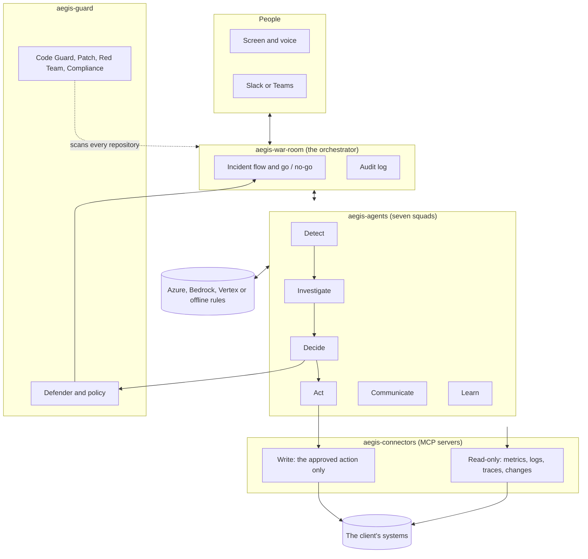

# The long-term goal

Where Aegis is going: from one repository and ten agents today, to a small family of repositories and about twenty-two agents that a client can run on their own systems.

| | Today | The goal |
|---|---|---|
| Repositories | 1 | 9, plus one private configuration repository per client |
| Agents | 10 | 22, in seven squads |
| Branches | `main` and `develop` (Gitflow) | the same Gitflow in every repository |
| How agents talk | function calls inside one process | separate services speaking open protocols (A2A between agents, MCP to tools) |
| Where it runs | your laptop | Kubernetes, deployed by GitOps |

One rule keeps this honest: **a repository or an agent is added only when its trigger is met.** Each one costs something to run, to secure and to explain. The tables below give the trigger for every one.

## The picture

## The repositories

| # | Repository | What lives there | Add it when |
|---|---|---|---|
| 1 | `aegis-war-room` | The orchestrator: incident flow, go / no-go, API, audit log. Today it holds everything | Exists now |
| 2 | `aegis-web` | The screen and the voice | A second front end appears (a Slack or Teams app), or someone works on the screen full time |
| 3 | `aegis-deploy` | Helm chart, settings per environment, GitOps. The one place that says which version of everything runs where | Aegis first runs on a shared cluster |
| 4 | `aegis-contracts` | The shapes agents exchange (finding, plan, verdict, decision), the model toggle, telemetry. The shared library every agent uses | Agents move out of the core repository |
| 5 | `aegis-agents` | The agents, grouped by squad, each released on its own | A second person or team writes agents |
| 6 | `aegis-connectors` | One MCP server per outside system: Prometheus, logs, Kubernetes, Argo CD, Datadog, PagerDuty, Slack. Read and write servers are separate | The third connector is written |
| 7 | `aegis-guard` | The defender's policy engine and policy packs, Code Guard, the Patch agent, the red-team drill, compliance evidence | A second product (Argus, for example) wants the same guard |
| 8 | `aegis-pipelines` | The CI and security workflows, written once and called by every repository | The third repository exists. Copied pipelines drift apart |
| 9 | `aegis-evals` | Recorded incidents and scoring: which model and which prompt handle them best. Blocks a release that scores worse | The second cloud model is in real use |
| + | `aegis-config-<client>` (private) | One client's runbooks, policy, voices and connector settings. Mounted at run time | The first client. Their data never enters the public code |

### In what order

| Phase | When | Repositories | Agents |
|---|---|---|---|
| 0. Hackathon | Now | 1 | 10 |
| 1. First hosted demo | A client can open it in a browser | 3: add `aegis-web`, `aegis-deploy` | 15 |
| 2. Platform | Agents run as separate services | 8: add contracts, agents, connectors, guard, pipelines | 18 |
| 3. Product | A paying client | 9 plus client config: add `aegis-evals` | 22 |

## Branches: Gitflow in every repository

Every repository has the same two long-lived branches and the same three short-lived kinds. Learn it once, use it everywhere.

| Branch | What it holds | Starts from | Merges into | Deploys to |
|---|---|---|---|---|
| `main` | Released code only. Every commit is a tagged release (`v1.4.0`) | | | Production |
| `develop` | The next release. Always passes CI | | | The dev environment, on every merge |
| `feature/<name>` | One piece of work | `develop` | `develop`, by pull request | |
| `release/<version>` | A release being steadied. Fixes only, no new features | `develop` | `main` (then tagged), and back into `develop` | Staging |
| `hotfix/<name>` | An urgent fix to what is live | `main` | `main` (then tagged), and back into `develop` | Production |

The rules, the same in every repository:

1. Nobody pushes straight to `main` or `develop`. Every change is a pull request.
2. A pull request needs the `ci` and `security` checks green and one approval.
3. Changes to the policy file, the security code or the pipelines need the owner's approval (`.github/CODEOWNERS`).
4. Versions follow semantic versioning: breaking change, new feature, fix.
5. Dependabot opens its pull requests against `develop`. A security fix for something already live goes through a `hotfix/` branch.

### How the repositories stay in step

- Each repository releases on its own. A tag on `main` builds a versioned image or package.
- `aegis-deploy` pins the version of each piece per environment. Promoting from dev to staging to production is a pull request there, and rolling back is reverting it.
- Every agent says which version of `aegis-contracts` it speaks. The orchestrator refuses an agent that speaks a version it does not know.

## The agents: 10 today, 22 at the goal

Each agent has one job. "Today" means it is in this repository and tested.

| Squad | Agent | Its one job | Phase |
|---|---|---|---|
| **Detect** | Watch | Notices trouble across many alerts, merges duplicates, opens one incident | 1 |
| | Triage | How bad is it, and which service is hurt? | Today |
| **Investigate** | Metrics | What do the numbers say? | 1 (today's Signals, split in three) |
| | Logs | What do the logs say? Quarantines text aimed at the AI | 1 |
| | Traces | Where does the time or the error come from? | 1 |
| | Changes | What changed just before? | Today |
| | Topology | What depends on the broken service? How far can this spread? | 2 |
| | Knowledge | Which runbook fits, and has this happened before? | Today as Runbook; past incidents in 2 |
| **Decide** | Planner | The root cause and one proposed action | Today |
| | Challenger | Argues against the plan. The planner must answer before the defender sees it | 2 |
| **Guard** | Defender | Checks the plan against fixed rules. Never a model | Today |
| | Code Guard | Scans every repository for vulnerabilities | Today |
| | Patch | Turns a scanner finding into a fix pull request. A human merges it | 2 |
| | Red Team | Invents new attacks every night. The ones that work become new drills | 3 |
| | Compliance | Collects the evidence an auditor asks for: who approved what, which checks ran | 3 |
| **Act** | Executor | Runs the approved action and nothing else | Today |
| | Verifier | Did it really recover? Raises the alarm if it gets worse | Today |
| **Communicate** | Briefer | The voice. Answers questions about the incident, not only reads the briefing | 1 |
| | Comms | Sends the approved update to Slack, Teams or the status page | 1 |
| | Scribe | Writes the postmortem draft | Today |
| **Learn** | Coach | After each incident, proposes a new alert, runbook or policy as a pull request | 3 |
| | Evaluator | Replays recorded incidents against every model and prompt change | 3 |

The human seats grow too:

| Seat | Their job | Phase |
|---|---|---|
| Incident commander | Go or no-go | Today |
| Service owner | Receives what the agents hand over | 1 |
| Second approver | A second go for any action rated medium risk or higher | 2 |

### Before an agent is added

It needs all six: one job; an answer with a fixed shape; its own identity with only the access that job needs; a test set that shows the incident goes better with it than without; offline rules to fall back to; a station on the screen. An agent that cannot show it helps is not added. Every agent is one more cost, one more delay and one more thing that can fail.

## How the ecosystem works

One incident, at the goal:

1. An alert arrives. **Watch** sees it belongs with two others and opens one incident. **Triage** rates it.
2. The **Investigate** squad works side by side. Each agent reads through a read-only connector. None of them can change anything.
3. **Planner** proposes one action from the allowed list. **Challenger** argues against it. The plan that survives goes on.
4. **Defender** checks the plan against the client's policy. Blocked plans go back once, then to a human.
5. **Briefer** tells the incident commander, by voice or in chat. For a risky action, a second approver is asked as well.
6. On go, **Executor** runs exactly the approved action through the one write connector it alone may use. **Verifier** watches the numbers.
7. **Comms** sends the approved update. **Scribe** drafts the postmortem. **Compliance** files the evidence.
8. Overnight, **Coach** proposes what would have caught this sooner, **Red Team** attacks the defences, and **Evaluator** replays the incident against any new model before it is released.

### How the pieces talk

| Between | Today | At the goal |
|---|---|---|
| Orchestrator and agents | Function calls in one process, sharing typed data | Each squad is its own service. They speak A2A, the open agent-to-agent standard |
| Agents and outside systems | Python functions in `aegis/connectors/` | MCP servers from `aegis-connectors`. Read-only for investigators, one write server for the executor |
| Agents and AI models | `aegis/brain.py` and `config/models.yaml` | The same toggle, plus a model and a spending limit per agent: a small model for triage, a strong one for planning |
| Who is who | One process, one identity | Every agent has its own identity. Messages are signed. Unknown agents are refused |
| The record | A chained log file on disk | The same chain, written to storage that cannot be edited |
| Seeing inside | The strips on screen | One OpenTelemetry trace per incident and one span per agent step, with cost, speed and test scores on dashboards |

## What stays true at any size

These are the reasons to trust it. No phase is allowed to weaken them.

1. Nothing changes without a human go, tied to the exact plan.
2. Agents choose from an allowed list. They never write their own commands.
3. The defender is rules, not a model.
4. Untrusted text is quarantined before any model reads it.
5. Every step is in the audit log.
6. It works with no cloud: every agent has offline rules.
7. The model and the cloud are settings, never code.

## Decisions still open

| Decision | The options |
|---|---|
| The shared library | A new `aegis-contracts`, or grow `agent-harness-sdk` so Argus and Aegis stand on one foundation |
| GitHub's default branch | Keep `main` (visitors see released code), or `develop` (pull requests target it without thinking) |
| Agents as services | One service per squad (cheaper, simpler) or one per agent (stronger isolation). Decide in phase 2 with real load |
| Licence | Keep everything MIT, or keep `aegis-guard` and the client configuration private |
